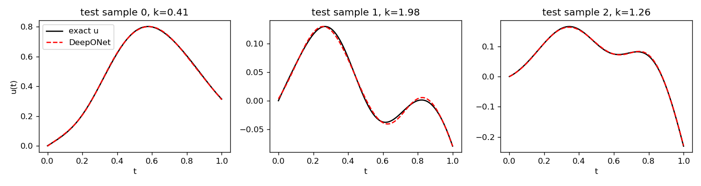

# DeepONet for a linear first-order ODE

[](https://huggingface.co/datasets/tha2002-tech/deeponet-ode-data)


A compact PyTorch example of operator learning. A DeepONet learns the map
(f, k) ↦ u for

```
u'(t) = -k · u(t) + f(t),   u(0) = 0,   t ∈ [0, 1]
```

where `f` is a random smooth forcing function and `k ∈ [0.1, 2]` is a damping
constant. The training data lives on the Hugging Face Hub at
[`tha2002-tech/deeponet-ode-data`](https://huggingface.co/datasets/tha2002-tech/deeponet-ode-data)
and is generated by `scripts/generate_data.py` in this repository.



## Results

| metric | value |
|--------|-------|
| test relative L2 error | 1.30 % |
| training time (CPU) | 296 s |
| train / test functions | 2000 / 500 |

## Quick start

```bash
pip install -e .
python -m deeponet_ode.train            # downloads tha2002-tech/deeponet-ode-data and trains
```

Outputs go to `results/`: `model.pt`, `metrics.json`, `predictions.png`.

Regenerate the data locally and train on it instead:

```bash
python scripts/generate_data.py          # writes data/
python -m deeponet_ode.train --local data
```

Push a regenerated dataset to your own Hub account:

```bash
hf auth login
python scripts/generate_data.py --push --repo YOUR_USER/deeponet-ode-data
```

## How it works

- **Data** (`src/deeponet_ode/data.py`): `f` is sampled from a Gaussian random
  field (RBF kernel, length scale 0.2) on a 991-point grid; `u` is the exact
  variation-of-constants integral computed by the cumulative trapezoid rule;
  both are stored at 100 equally spaced points. Splits are Parquet files with
  columns `f_sensors`, `k`, `t`, `u`.
- **Model** (`src/deeponet_ode/model.py`): branch MLP 101→128→128→64 on
  `[f_sensors, k]`, trunk MLP 1→128→128→64 on `t`, output is their dot product
  plus a bias. Input standardization statistics are stored in the checkpoint.
- **Training** (`src/deeponet_ode/train.py`): Adam, MSE, cosine learning-rate
  decay, 600 epochs with batches of 64 functions × 100 query points.

## Dataset ↔ code link

- The dataset card on the Hub names this repository, the generator script and
  the git commit that produced the files; `metadata.json` there records every
  parameter and the sensor grid.
- `train.py` defaults to the Hub dataset id, so a fresh clone trains with no
  manual data step.

## Development

```bash
pip install -r requirements.txt
pytest
```

Troubleshooting on Windows + conda: if you see `OMP: Error #15` about
`libiomp5md.dll`, set `KMP_DUPLICATE_LIB_OK=TRUE` (the training script sets it
for itself).

## Reference

Lu, L., Jin, P., Pang, G., Zhang, Z., Karniadakis, G. E. (2021). Learning
nonlinear operators via DeepONet based on the universal approximation theorem
of operators. *Nature Machine Intelligence* 3, 218–229.

## License

MIT
